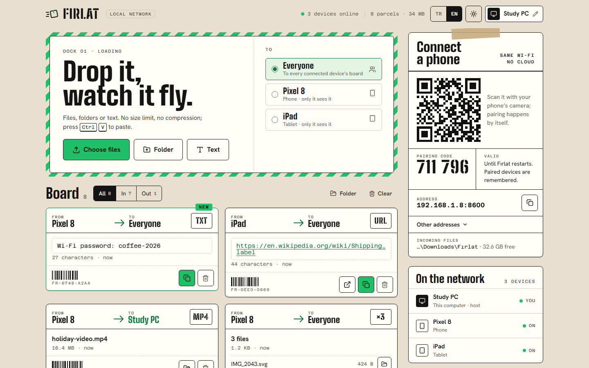
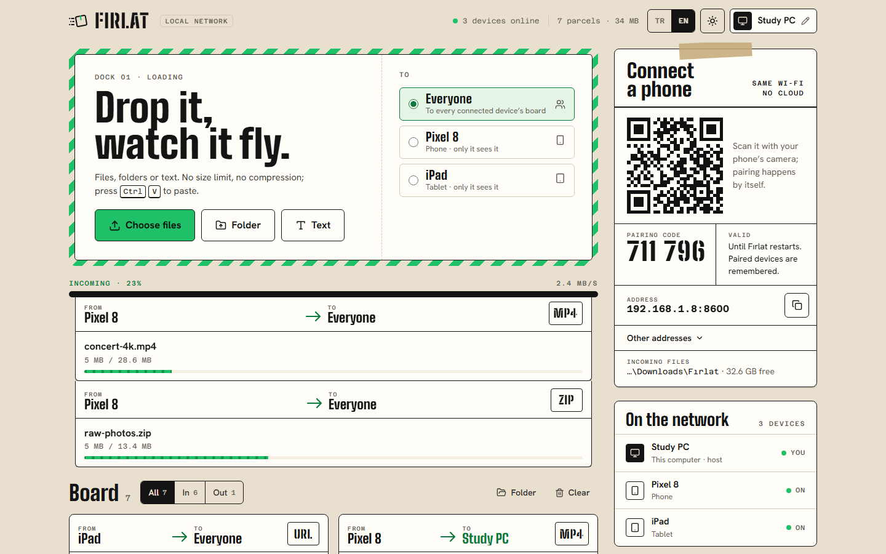

<h1>
<picture>
  <source media="(prefers-color-scheme: dark)" srcset="assets/mark-dark.svg">
  
</picture>
Fırlat
</h1>

**Send files and text across your own Wi-Fi.** One computer runs Fırlat; every phone, tablet and laptop on the same network joins from the browser. Nothing to install on the phone, no account, no cloud, no size limit.

*Fırlat* is Turkish for "throw" (say it *fur-LAHT*).

<picture>
  <source media="(prefers-color-scheme: dark)" srcset="assets/screens/board-dark.png">
  
</picture>

## What it does

- **Files, folders and text.** Drop anything on the page, pick files or a whole folder, or paste with <kbd>Ctrl</kbd> <kbd>V</kbd>. Links open in one tap; text copies in one tap.
- **To everyone or to one device.** Choose a recipient before you send. A parcel for one device shows up only on that device, the sender and the host.
- **No size limit, no compression.** Uploads stream straight to the host's disk; downloads resume; several files come down as one ZIP.
- **Pair once.** Scan the QR code on the host, or type its 6-digit code. The device is remembered after that.
- **Live.** New parcels, devices joining and transfers in progress appear on every screen as they happen.
- **Turkish and English.** It follows the browser's language; the switch sits in the header.
- **Light, dark or system theme**, and it works on a phone as well as on a desktop.

## Run it

You need **Python 3.10 or newer**. Nothing else: the server uses only the standard library, and the built interface is already in `static/`.

```
python server.py
```

On Windows you can double-click `baslat.bat` instead. The browser opens `http://localhost:8600`, and the console prints the address and pairing code for other devices.

- **Phones:** scan the QR code on the "Connect a phone" label. Typing the address works too; then enter the 6-digit code.
- **Firewall:** the first time, Windows asks whether Python may use the network. Allow it on **Private networks**. If your Wi-Fi is set to "Public", phones can't connect.
- **Received files** land in `Downloads/Fırlat`.

### Settings

| Variable | Default | What it does |
|---|---|---|
| `FIRLAT_PORT` | `8600` | Port to listen on; the next free one is tried if it is taken |
| `FIRLAT_DIR` | `~/Downloads/Fırlat` | Folder for received files |
| `FIRLAT_DATA` | `./data` | Board index and the pairing secret |
| `FIRLAT_BIND` | `0.0.0.0` | Interface to listen on |
| `FIRLAT_OPEN` | off | `1` turns pairing off: anyone on the network can connect |
| `FIRLAT_NO_BROWSER` | off | `1` doesn't open a browser on start |
| `FIRLAT_LANG` | system | `tr` or `en` for the console text |

## How it works

<picture>
  <source media="(prefers-color-scheme: dark)" srcset="assets/screens/receiving-dark.png">
  
</picture>

1. **One host.** The computer running `server.py` serves the interface, stores received files and keeps the board in `data/index.json`.
2. **Pairing.** Devices other than the host must enter the pairing code. It changes on every start, and the QR code carries it in the link. A correct code sets an HttpOnly cookie, so the device stays paired. Eight wrong codes from one address lock pairing for five minutes.
3. **Transfers.** Uploads are raw `PUT` requests streamed to disk in 1 MiB chunks, written to a `.part` file and renamed when complete. Downloads support HTTP ranges. A batch downloads as a streamed ZIP without compression.
4. **Live updates.** Every open page keeps a Server-Sent Events connection for new parcels, devices and upload progress.

### Security, honestly

- **Nothing leaves your network.** There are no accounts, no telemetry and no cloud.
- **Pairing keeps strangers out**, but paired devices are trusted. Who sees a parcel meant for one device is decided by the server from the device's ID, not by encryption.
- **No encryption on the wire.** Fırlat speaks plain HTTP inside your network, so use it on networks you trust, like your home Wi-Fi, and not on a café hotspot.
- **Protected changes.** Every request that changes something needs an `X-Firlat` header, so other websites can't trigger it. Only the sender or the host can delete a parcel, and only the host can clear the board or open its folder.

## Design: Kargo

Every parcel on the board is a shipping label: the route (FROM → TO) in Big Shoulders, the file type stencilled in a box, a barcode made from the tracking code, and the actions below a dashed tear line. The drop zone is a striped loading dock. "Connect a phone" is a printed label taped to the side, with the QR code as its barcode. Outgoing files ride a conveyor belt, and incoming ones print out of a slot.

- **Typefaces:** Big Shoulders Stencil (logo, codes), Big Shoulders (headings, routes), Hanken Grotesk (interface) and Azeret Mono (label fields).
- **Light theme:** kraft board `#e8dfcf` with white labels.
- **Dark theme:** plain black `#0d0d0d`.
- **Accent:** one cargo green.
- **Motion:** animations stop when the system asks for reduced motion.

## Develop

```
cd frontend
npm install
npm run dev               # Vite on :5173, /api goes to :8600
npm run build             # writes ../static
node tools/check-i18n.mjs # every Turkish string has English
```

Turkish is the source language: each interface string is written in Turkish and used as its own key, and `frontend/src/en.js` holds the English. To make the screenshots above, run `python tools/screenshots.py`; it needs Playwright, and it uses its own throwaway folders.

## Licence

MIT, see [LICENSE](LICENSE). The bundled fonts are under the SIL Open Font License; see [THIRD-PARTY.md](THIRD-PARTY.md).

---

## Türkçe

**Yerel ağda dosya ve metin fırlat.** Bir bilgisayarda çalışır; aynı Wi-Fi'deki telefon, tablet ve bilgisayarlar tarayıcıdan bağlanır. Telefona bir şey kurman gerekmez: hesap yok, bulut yok, boyut sınırı yok.

**Çalıştırmak için** Python 3.10 ya da üstü yeter.
- `python server.py` çalıştır; Windows'ta `baslat.bat` dosyasına çift tıklaman da olur.
- Telefonla "Telefonu bağla" etiketindeki QR'ı okut ya da 6 haneli kodu gir.
- Windows Güvenlik Duvarı sorarsa Python'a **Özel ağlar** için izin ver.
- Gelen dosyalar `İndirilenler/Fırlat` klasörüne düşer.

**Arayüz:** Türkçe ve İngilizce; tarayıcının dilini izler, başlıktaki TR/EN düğmesiyle değişir.

**Güvenlik:** Trafik şifrelenmez, Fırlat ağ içinde düz HTTP kullanır. Bu yüzden ev Wi-Fi'si gibi güvendiğin ağlarda kullan.
